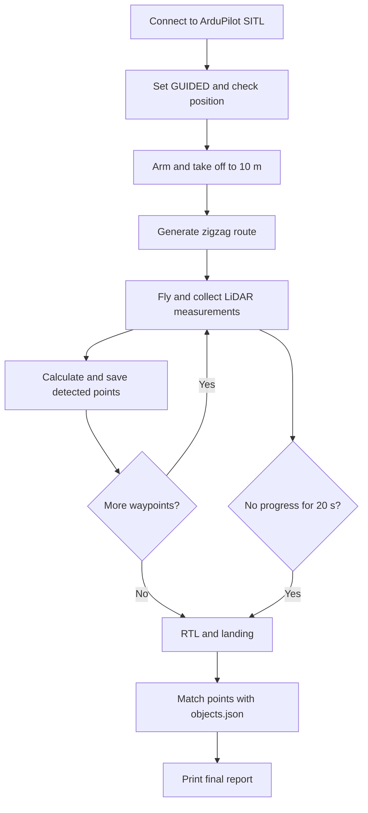

# Rescue Drone Simulator

A simple autonomous search and rescue drone project made for the **AGH Solar Plane 2026 recruitment task**.

The idea is to simulate a drone looking for people in a selected area. I used **Python, PyMAVLink, ArduPilot SITL and a simulated LD06 LiDAR**. The project was tested in Mission Planner on Windows and also developed with SITL on macOS.

**Important:** This is only a simulation project, not software ready for a real drone. Right now **my Python code does not avoid obstacles and does not check whether the planned path is safe**. The LiDAR is used for collecting object positions, not for avoiding collisions. For the successful full-route SITL test, I disabled ArduPilot's built-in avoidance (`AVOID_ENABLE = 0`). This setting is only for testing in the simulator.

## 1. Mission idea

The drone takes off to 10 m and searches an area using a zigzag route. While flying, it receives distance measurements from the simulated LiDAR and calculates approximate object positions. The points are saved to a JSON file. After the route, the drone returns to its starting position (RTL) and lands.

At the end, the program compares collected points with objects from `data/objects.json`. If a point is close enough to an object marked as `person` (less than **1.5 m**), it counts as a found person. Multiple detections of the same person are counted once.

**This is not real human recognition.** The LiDAR only gives distances. The person's type comes from the prepared JSON data. I chose this approach because the task allows simulated detection, and I wanted to focus on MAVLink communication and running the whole mission.

### Mission flow



Current route settings in `src/main.py`:

- Search width: **100 m**
- Search length: **300 m**
- Distance between sweeps: **30 m**
- Takeoff altitude: **10 m**

This produces **21 movement segments**. For faster tests I also used `generate_search_route(20, 40, 10)`, which produces 9 segments.

## 2. Project structure

```text
rescue-drone-simulator/
├── data/
│   ├── objects.json                  # Reference objects for the simulation
│   └── detected_points.json          # Created/overwritten during a mission
├── src/
│   ├── main.py
│   ├── drone_controller.py
│   ├── sensor_management.py
│   ├── detection_management.py
│   └── simulation_management.py
├── tests/
│   ├── test_drone_controller.py
│   ├── test_sensor_management.py
│   ├── test_detection_management.py
│   └── test_simulation_management.py
├── pytest.ini
├── requirements.txt
└── README.md
```

### Modules

| File | What it does |
| --- | --- |
| `main.py` | Starts the connection, runs the mission and prints the report. |
| `drone_controller.py` | ARM, TAKEOFF, GUIDED/RTL, waypoint movement, landing and timeout handling. |
| `sensor_management.py` | Reads/validates LiDAR data and calculates object X/Y coordinates. |
| `detection_management.py` | Removes near-duplicate points (under 1 m apart) and saves/reads them from JSON. |
| `simulation_management.py` | Compares detections with reference objects and counts found people. |

Coordinates are calculated in the local **NED** system (X = north, Y = east, Z = down). I use the drone position and heading, plus the LiDAR measurement direction, to calculate a point in this coordinate system.

## 3. Installation

Tested with **Mission Planner on Windows**. You need Python (I used Python 3.11 for the Windows setup), Mission Planner with SITL support and the packages listed in `requirements.txt`.

In PowerShell, from the main project directory:

```powershell
py -3.11 -m venv .venv
.\.venv\Scripts\Activate.ps1
python -m pip install -r requirements.txt
```

If PowerShell does not allow activation, you can run commands using `.venv\Scripts\python.exe` instead.

**Working directory:** Right now the code uses relative paths like `../data/objects.json`. For that reason, run the mission **from the `src` directory**:

```powershell
cd src
python main.py
```

In PyCharm, set the run configuration's **Working directory** to `src`. Otherwise Python may not find `objects.json` or may save detections in the wrong place.

## 4. Mission Planner / SITL setup

This was the most important part of setting up the simulation. A default Mission Planner Copter simulation was enough to fly, but it **did not send `DISTANCE_SENSOR` messages** until I enabled the simulated LiDAR.

### 4.1 Start SITL with LD06

1. Install [Mission Planner](https://ardupilot.org/planner/docs/mission-planner-installation.html) on Windows.
2. Open the **SIMULATION** tab and select **Copter / Quad**.
3. In **Extra command line**, enter:

   ```text
   --serial5=sim:ld06 --home=51.8752066,14.6487840,54.15,0
   ```

4. Start the simulation. If it was already running, restart SITL after changing the arguments.
5. Connect Mission Planner to the simulated vehicle.

`--serial5=sim:ld06` starts the virtual LD06 device. The `--home` argument sets the test location used for this simulation. Do not add `-A` here: that option is for running SITL with `sim_vehicle.py`, not directly from Mission Planner.

### 4.2 Parameters

In Mission Planner go to **CONFIG → Full Parameter Tree** (or **Full Parameter List**) and check:

| Parameter | Value used | Why |
| --- | --- | --- |
| `SERIAL5_PROTOCOL` | `11` | Serial port used for proximity sensor data. |
| `PRX1_TYPE` | `16` | LD06 proximity LiDAR. |
| `OA_TYPE` | `0` | No automatic obstacle path planning. |
| `AVOID_ENABLE` | `0` | Built-in avoidance disabled **only for the full-route SITL test**. |

Use **Write Params** and check the values again. In my tests, some parameters returned to their defaults when I restarted the simulation. If this happens, make sure they are saved and check them after restarting SITL.

You can also try loading a parameter file at startup if the values keep resetting. For example, a file `ld06.parm` could contain:

```text
SERIAL5_PROTOCOL 11
PRX1_TYPE 16
OA_TYPE 0
AVOID_ENABLE 0
```

Then add `--defaults="FULL_PATH_TO_ld06.parm"` to the SITL **Extra command line** and verify that your Mission Planner version applies it. This is an optional way of making setup easier; the test results below were obtained after checking the actual parameters in SITL.

**Important:** `AVOID_ENABLE = 0` means the autopilot is not using that built-in obstacle-avoidance feature. My code also has no collision avoidance, so the drone may fly into an obstacle. Never use this setup as a safe configuration for a real aircraft.

### 4.3 MAVLink connection

My Python code uses:

```python
connection = mavutil.mavlink_connection("udpin:127.0.0.1:14550")
```

The SITL connection must forward MAVLink data to UDP port **14550** on the same computer. If no heartbeat arrives, check the forwarding/port settings. Don't assume all Mission Planner configurations use this port automatically.

You can test the connection with:

```python
from pymavlink import mavutil

connection = mavutil.mavlink_connection("udpin:127.0.0.1:14550")
if connection.wait_heartbeat(timeout=15) is None:
    raise TimeoutError("No heartbeat received")
print("Connected to ArduPilot")
```

### 4.4 Check if LD06 works

Before starting the whole mission, I recommend checking whether Python receives LiDAR data:

```python
from pymavlink import mavutil

connection = mavutil.mavlink_connection("udpin:127.0.0.1:14550")
if connection.wait_heartbeat(timeout=15) is None:
    raise TimeoutError("No heartbeat received")

for _ in range(10):
    message = connection.recv_match(
        type="DISTANCE_SENSOR", blocking=True, timeout=2
    )
    if message is None:
        print("No DISTANCE_SENSOR message")
    else:
        print(message.current_distance, message.orientation)
```

In my working setup I received data from orientations **0–7**, including distances like **273 cm, 256 cm and 1130 cm**. If every message is `None`, check `--serial5=sim:ld06`, `SERIAL5_PROTOCOL`, `PRX1_TYPE` and the MAVLink connection.

Stop this diagnostic script before launching `main.py`.

The obstacles detected by the simulated LD06 come from the **simulator environment**, not from the satellite image in Mission Planner. `objects.json` is a separate file used to decide which detected positions represent people.

## 5. Running the mission

1. Start SITL in Mission Planner with the LD06 configuration described above.
2. Check that the drone is **on the ground and disarmed**.
3. Make sure `data/objects.json` is present and the LiDAR test receives data.
4. Open a terminal in the project, activate `.venv` and run:

   ```powershell
   cd src
   python main.py
   ```

The program should connect, switch to `GUIDED`, wait for a valid position estimate, arm, take off, fly the zigzag route and record LiDAR detections. At the end of the route it requests **RTL**, waits for landing and disarming, then prints the number and coordinates of matched people.

Detected points are saved in `data/detected_points.json`. The list starts empty at the beginning of a mission and is saved after each segment, including when a route is interrupted.

## 6. Tests and results

### Unit tests

I used **pytest** with `MagicMock` and `patch` to test the code without needing SITL for every check. Tests cover:

- Creating the zigzag route, including wrong parameters.
- MAVLink ACK responses, arming, takeoff, flight modes and simulated waypoint movement.
- Timeout cases and trying RTL after a flight error.
- LiDAR measurements and calculating positions.
- Saving points, removing duplicates and matching them with people from JSON.

Run all tests from the **main project directory**:

```powershell
python -m pytest -v
```

`pytest.ini` is set up to find imports from `src`:

```ini
[pytest]
pythonpath = src
testpaths = tests
```

### Mission Planner tests (18 October 2026)

| Test | What happened |
| --- | --- |
| Short route (20 × 40 m, spacing 10 m) | All **9/9 segments** completed, RTL and landing successful; **1** person matched. |
| Full route (100 × 300 m, spacing 30 m, `AVOID_ENABLE=0`) | All **21/21 segments** completed, RTL and landing successful; return distance around **0.01 m**; **2** people matched; exit code **0**. |
| Full route with `AVOID_ENABLE=3` | Drone repeatedly stopped on the last segment around X = 72 m, about 27–29 m before the target. After 20 s without enough progress, my code interrupted the route and requested RTL. The drone returned and landed. |
| SITL without the LD06 setup | Python received heartbeat, but no `DISTANCE_SENSOR` messages. |

The comparison suggests that the built-in ArduPilot avoidance settings caused the repeated stop on the long route. I did not identify the exact simulated obstacle, so I treat this as a likely explanation, not a confirmed collision event.

### Error handling

I added several checks: timeouts when telemetry is missing, checking ACK results, checking if the drone is already in the air before takeoff, rejecting invalid sensor measurements and checking progress toward waypoints.

If the distance to a waypoint does not improve by at least **0.2 m** for **20 seconds**, `move_drone()` raises `TimeoutError`. `fly_route()` saves the collected points and tries RTL in `finally`. `main.py` also prints the detected people after a route error.

This is basic error handling, not a complete flight safety system. RTL is attempted but cannot be guaranteed if the connection or autopilot fails.

## 7. Current limitations

- **No obstacle avoidance in my code.** The drone follows the generated route and does not check whether it might hit a tree or another obstacle. The LiDAR detections are recorded, but are not used to change the route.
- With `AVOID_ENABLE=0`, ArduPilot's built-in avoidance is also disabled for the successful SITL test. This must not be treated as safe for real flights.
- **No actual people recognition.** People are identified by comparing positions with known objects from `objects.json`. There is no camera or trained model yet.
- The LiDAR calculations are simplified to 2D positions and 8 directions. I am not fully accounting for sensor noise, synchronization or 3D geometry.
- The planned route is fixed and cannot adapt during the mission.
- I currently use relative file paths, so the working directory matters.
- The code was made for testing in SITL; it still needs a lot of safety work before using a real drone.

## 8. Future improvements

If I continued the project, I would like to add:

1. **Obstacle avoidance.** Use LiDAR readings not only to save points but also to detect obstacles in the drone's path, stop, find a free direction and return to the planned route. At the moment the drone **doesn't avoid obstacles and doesn't react to a possible collision**.
2. **Visualization.** A simple live map or application showing the route, current drone position, LiDAR points and confirmed people. This would also make debugging easier.
3. **AI person detection.** Add an RGB or thermal camera and use an object-detection model to recognize people, instead of relying on known coordinates in `objects.json`.
4. **Better mission planning.** Recalculate the route when a part of the area can't be reached or when a new detection needs checking.
5. **Function documentation.** Add proper docstrings to the functions I wrote, describing their parameters, returned values, possible exceptions and the MAVLink messages they use. At the moment the code is divided into modules, but individual functions could be documented better.
6. **More reliable error handling.** Better connection-loss handling, logs and more ways to recover if RTL fails.

## 9. Sources and tools

- [Mission Planner Simulation](https://ardupilot.org/planner/docs/mission-planner-simulation.html)
- [ArduPilot simulated devices / LiDAR](https://ardupilot.org/dev/docs/adding_simulated_devices.html)
- [ArduPilot SITL](https://ardupilot.org/dev/docs/using-sitl-for-ardupilot-testing.html)
- [MAVLink message reference](https://mavlink.io/en/messages/common.html)
- [PyMAVLink](https://mavlink.io/en/mavgen_python/)
- [pytest documentation](https://docs.pytest.org/)

I used ArduPilot, Mission Planner, PyMAVLink and pytest, along with documentation and AI assistance while writing and testing the project.
